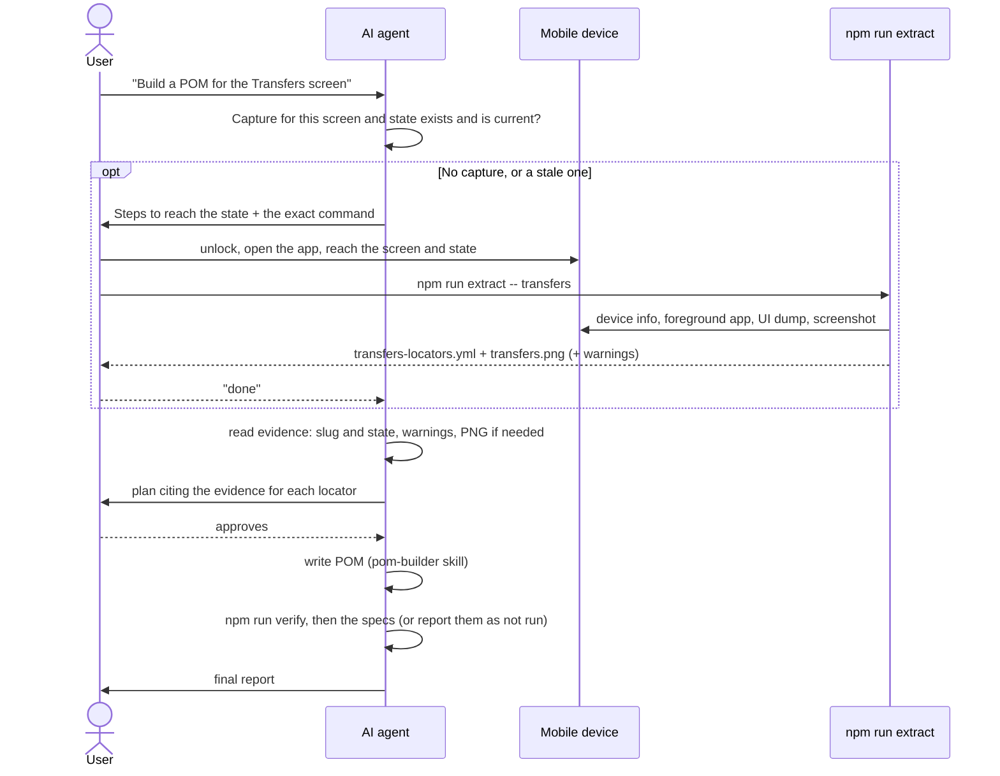

# AI Integration — UI Evidence & POM Generation

How AI agents (Claude Code, Cursor, Codex, Antigravity, …) write Page Objects in this
framework without inventing locators. Agent rules live in [`AGENTS.md`](../AGENTS.md);
the procedures live in skills under [`.agents/skills/`](../.agents/skills/).

---

## The core rule: evidence, not invention

AI models write good TypeScript but are bad at *guessing* how a mobile screen is built.
Asked for a locator on a screen they can't see, they fabricate labels and roles that
look right and fail at runtime. So agents may only write a locator backed by evidence:
a capture of the real screen, existing code that a passing test exercises, or the
user's own statement (AGENTS.md §4).

---

## The workflow



The agent picks the slug and gives you the exact command, so capture names stay
consistent; it runs the command itself only when you ask. You can also capture
several screens up front: the agent then only reads the files.

The two skills involved:

| Skill | Covers |
|---|---|
| `mobilewright-ui-tree-extractor` | when a capture is needed, getting the device into the right state, running the extractor, reading the capture and its warnings |
| `mobilewright-pom-builder` | choosing the locator from the evidence, writing the POM, waits, verify methods |

---

## Capturing a screen

You run the capture; when an agent needs one, it tells you the slug and the steps.
Unlock the device, open the app on the target screen **and state**, close the
keyboard (unless it is part of the state), then:

```bash
npm run extract -- <slug>          # slug = screen + state, e.g. home, login-invalid-credentials
                                   # needs DEVICE_ID in .env (see README › Configuration)
npm run extract -- <slug> --raw    # also save mobilecli's unfiltered dump
```

| File (in `.ui-evidence/`) | When | Purpose |
|---|---|---|
| `<slug>-locators.yml` | always | **The evidence.** The only file agents read by default |
| `<slug>.png` | always | Screenshot, to confirm the state (keyboard, dialogs, right data). **Not redacted** |
| `<slug>-raw.json` | `--raw` only | Untouched dump, for debugging the extractor or the driver. A capture without `--raw` deletes an older one for the same slug |

`.ui-evidence/` is **local to each machine and never committed**: on a fresh clone,
capture the screens you need.

The extractor refuses to capture when the device is locked, a different app is in
front, or the device isn't Android (only Android is implemented today; emulators use
the same code path but haven't been verified yet).

---

## The evidence file

A real capture of the Home screen (trimmed):

```yaml
# UI Evidence — home1
# Captured: <timestamp> · app <bundle-id> v<version> · device <model>, android <n>, real · screen <width>x<height>
# Redacted: text typed into text fields. NOT redacted: labels, static text, and the screenshot (all may contain names/emails).
# role: Mobilewright getByRole role ("none" = no role; use getByLabel / getByText). at: x,y widthxheight (px).
# focused / checked / selected are listed only when true.
# Locator priority: getByTestId(identifier) > getByLabel > getByRole > getByText.

elements:
  - role: none
    type: View
    label: "Avatar"
    at: 56,180 144x144
  - role: none
    type: View
    label: "Hi,"
    at: 228,217 66x70
  - role: none
    type: View
    label: "Quick actions\nAccounts\nCertificates\nTime Deposits\nRecent Transfers\nNo recent transfer\nOffers"
    at: 0,1258 1264x1113
    children:
      - role: none
        type: View
        label: "Transfer"
        at: 56,1398 204x263
      - role: image
        type: ImageView
        label: "Donate"
        at: 372,1398 204x263
  - role: button
    type: Button
    label: "Transfers\nTab 2 of 4"
    at: 365,2413 267x196

warnings:
  - "no-identifiers: no app element has a test id here, so getByTestId cannot be used on this screen"
```

From this, the agent writes:

```typescript
// role none + unique exact label ("Avatar\n…" account cards don't match an exact label)
private getAvatar() {
  return this.screen.getByLabel('Avatar');
}

// tiles mix View and ImageView (no shared role) → label, scoped to the merged section
private getQuickAction(action: QuickAction) {
  return this.screen.getByText(/^Quick actions\n/).getByLabel(action);
}

// multi-line label → anchored regex on the fixed part
private getTab(tab: NavTab) {
  return this.screen.getByRole('button', { name: new RegExp(`^${tab}\\n`) });
}
```

### What the extractor does for you

| It | Why |
|---|---|
| Drops system UI (status bar, nav bar), layout wrappers and empty nodes | Noise an agent would otherwise read and pay tokens for |
| Adds `role` from Mobilewright's own role table | The agent uses the exact role `getByRole` matches; `none` (e.g. `View`) means `getByRole` can't match it |
| Adds `at` and `offscreen` / `zeroSize` flags | Shows what needs scrolling and what Mobilewright treats as invisible |
| Redacts text typed into any text field | Typed data never lands in evidence or code |
| Keeps text exactly as the device reports it (untrimmed) | Mobilewright matches text exactly, so what you see is what a locator must match |
| Writes invisible characters as `\uXXXX` (e.g. `\u200e`) | They are real characters in the label; without the escape an exact name copied from the file fails |
| Records app version, device and screen size | Shows where and on what the capture was made. Dev builds often keep one version across builds, so the version alone does not prove a capture is current |

### Warnings

| Warning | Meaning |
|---|---|
| `duplicate "<value>": <locators>` | The listed locators match several elements with that value (counted the way Mobilewright matches: `getByText` falls back to the label, a `getByRole` name to the text). Mobilewright has no strict mode, so the locator silently uses the first. Scope by a container |
| `keyboard` | A text field is focused; the keyboard may be open (it never appears in the dump) and cover lower elements. Check the PNG |
| `no-handle` | An interactive element has no label, text or identifier, so it can't be located reliably. Ask the app team for a Semantics label/identifier |
| `offscreen` / `zero-size` | Needs scrolling / not visible to Mobilewright |
| `overlay` / `windows` | Another Android window (system dialog, another app) is on screen; the capture may not match what a test sees. Flutter's own dialogs, bottom sheets and dropdowns are **not** detected: they appear as a full-screen labelled View (e.g. `"Scrim"`, `"Dismiss"`), so check the PNG |
| `no-identifiers` | The app sets no test ids on this screen, so `getByTestId` is unavailable |
| `app: … could not determine` | mobilecli couldn't confirm the foreground app (an intermittent device issue); check the PNG |

---

## When the AI asks for a capture, and when it doesn't

Asks you to capture when:
- it adds or changes a locator and no capture exists for that screen and state;
- the capture is stale (you say the screen changed, a passing test contradicts it,
  or the header's app version differs from the installed one).

Needs no capture when:
1. it composes new methods from **existing** locators;
2. it only refactors structure, signatures or logic;
3. the user gives the locator, or pastes a capture, in the prompt.

---

## How to prompt the AI

Give the **intent**, the **screen**, and how to **reach the state**:

> *"Build a POM for the Transfers screen. Log in, decline the biometric popup, then tap
> the Transfers tab. Capture it and build `TransfersPage`."*

> *"The Home screen was redesigned. Re-capture it and update the locators in
> `HomePage.ts`. No logic changes."*

> *"Here is `home1-locators.yml`: [paste]. Build the `HomePage` POM from this."*

> *"Rename `HomePage.openQuickAction` to `startQuickAction` and update its callers.
> No locator changes."* (no capture needed)
